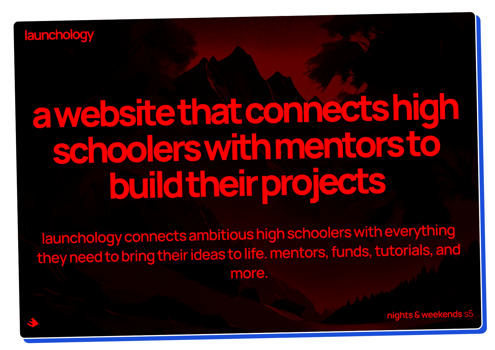
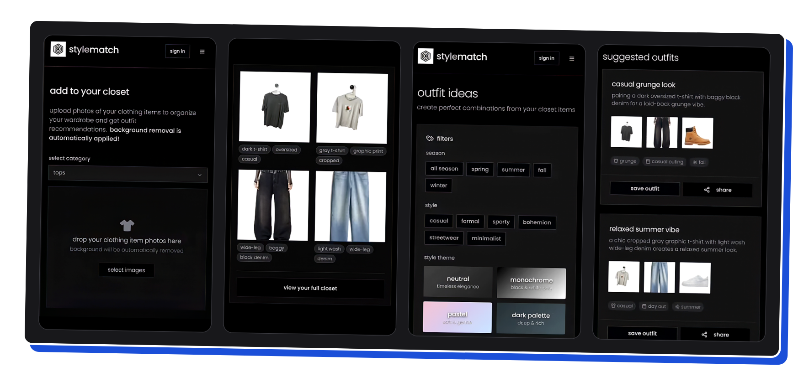
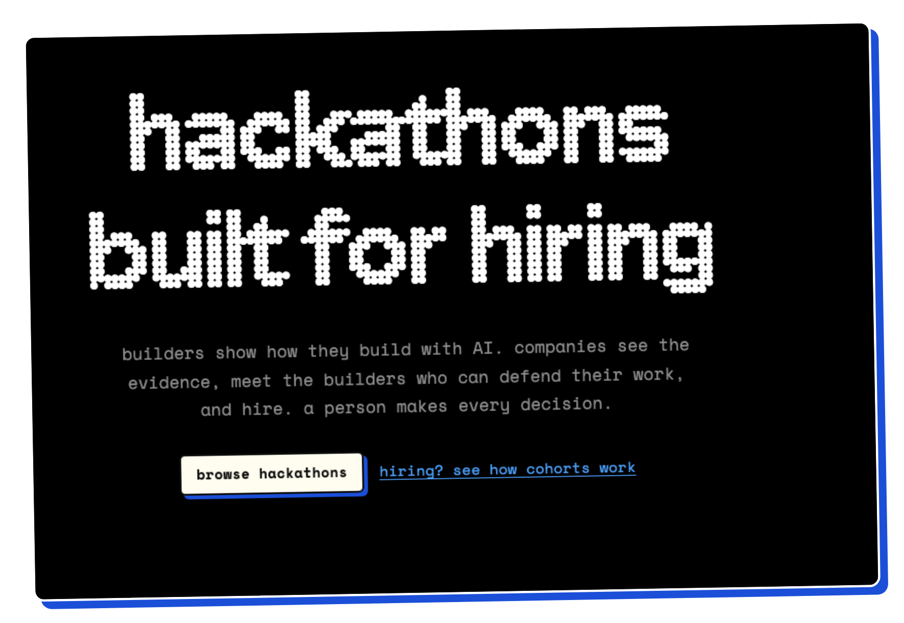
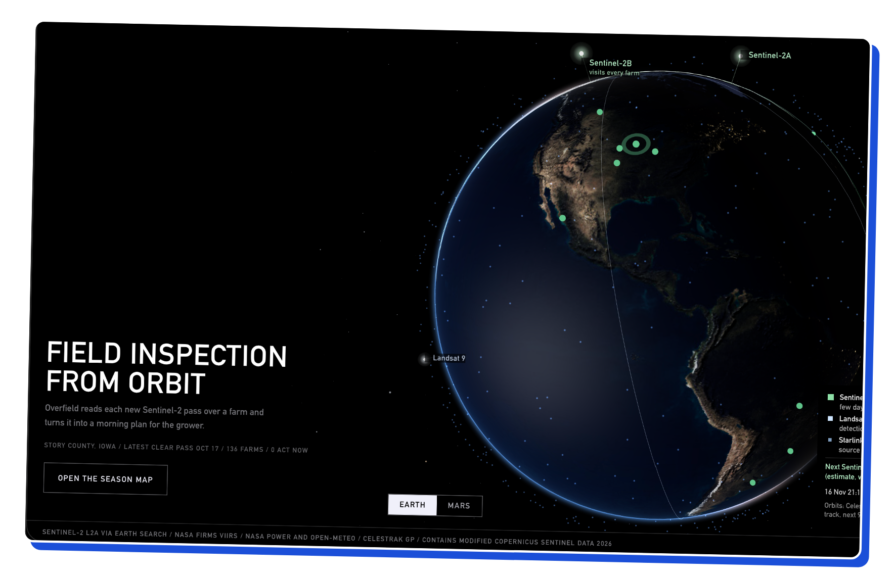
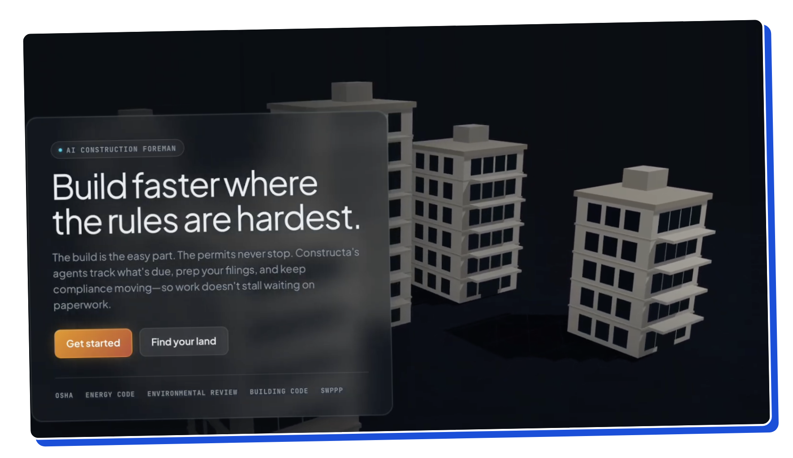

  
  

### i'm from san diego and study computer science and informatics at the [university of washington](https://www.washington.edu/).

### at uw i'm part of the [lavin entrepreneurship program](https://uwlavin.com), the technology consulting association, the venture capital club, [cseed's buildspace fellowship](https://cseed-buildspace.vercel.app) and the [AI collective's research program](https://www.aicollective.com).

### scroll through to see some of the things i've built!

 

## [launchology](https://launchology-jade.vercel.app/)

I started launchology during **Buildspace's Nights & Weekends** because most high schoolers with an idea for a project have no mentors or funding to help them build it. it became a free two-month program for students to build AI and robotics projects.

- the first version was a **mentor-matching app** I wrote on Replit that scored each mentor and student pair on the project categories they had in common
- students from **31 countries** joined through our posts on Discord, TikTok and Instagram and our outreach to schools
- every team chose its own problem and finished the program with an MVP or a demo after weeks of office hours and project reviews with mentors who work in tech
- I raised the program's funding from sponsors including **Wolfram** and **ELEGOO**
- the program ended with our **AI for Change hackathon** on using AI for problems like ocean conservation and climate sustainability

my co-founder and I are now reopening launchology for short builds in software, hardware, film or music that each end with a public demo.

 

## [stylematch](https://github.com/niranjan-deshpande1/Stylematch)

I learned full-stack development by building stylematch on my own after noticing how hard it was for me and a lot of other people to pick an outfit.

- each clothing photo has its background removed in the browser and is tagged by an **OpenAI vision model** using a fit and style vocabulary I wrote
- a saved outfit photo is compared with your closet to show how much of the look you already own and which pieces you'd have to buy
- the app only shows an outfit suggestion after checking that every item in it is in your closet

about **6,000 people** used it during the year it was live.

 

## [firefly](https://github.com/niranjan-deshpande1/firefly)

startups have a hard time telling who can build now that AI lets a candidate look skilled in applications and technical assessments without understanding the code they turn in. a couple of friends and I built firefly for a pitch competition as a hiring platform where companies find people by watching how they build with AI during a two-week hackathon.

- companies describe the roles they're hiring for at the start and get a **shortlist with a report on each builder** at the end
- two reviewers score every project with **names and schools hidden** and have to tie each score to something in the project's commit history, AI transcripts or decision log
- builders who advance defend their project in an interview by walking through the code, making a live change and **fixing a bug planted in their own repository**
- a person makes every advance and hire decision because nothing in firefly scores or rejects candidates on its own

 

## [harvest radar](https://ishaanmakam.github.io/harvest-radar)

my team built harvest radar at DubHacks 2026 to turn each clear satellite pass over a farm into a morning task list for the farmer. we started from the problem in Punjab of farmers burning their fields when straw-clearing machines show up late after the rice harvest.

- I built the **data pipeline** that combines Sentinel-2 imagery from Earth Search with weather from NASA POWER and Open-Meteo and fire detections from NASA FIRMS to produce greenness and burn-index time series for every field
- each field is checked after every pass for harvest readiness, crop stress, flooding, burn scars and active fires before the plan reaches the farmer by phone call and text in their language
- for the SpaceX track we added a **Mars view** that checks every 7 km of the planet against four Starship landing rules (ice within reach, low ground, ground that can take the engine plume and science targets nearby) using NASA, USGS and PSI orbital data

 

## [constructa](https://github.com/shubhaych/Constructa)

construction projects regularly fall behind schedule and over budget while project managers chase permits and compliance paperwork by hand. my team won the **Fetch.ai and Browserbase tracks** at the CalHacks AI hackathon at UC Berkeley with constructa. it checks whether a site is worth building on before any money is spent and then handles the permit and compliance work at every stage of the build.

- you pick a plot of land on a map of US districts and a set of **Fetch.ai agents** scores it on zoning, permit speed, hazards, land cost and infrastructure using live data they pull through **Browserbase's headless browsers**
- you describe the building in plain language and the app lays out a **3D model** of it on the site
- a construction timeline lists the compliance work and local laws for each stage and fills out the permit forms as the build moves forward
